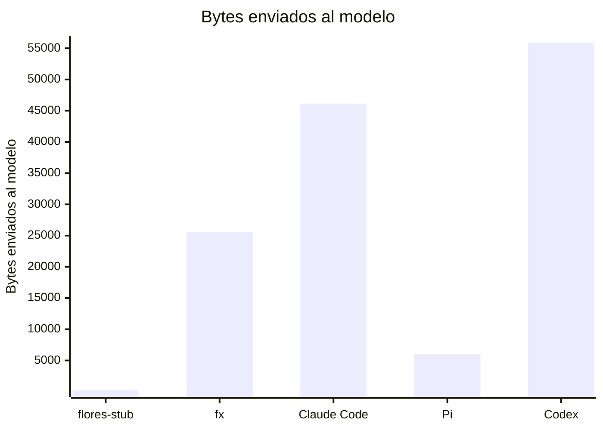
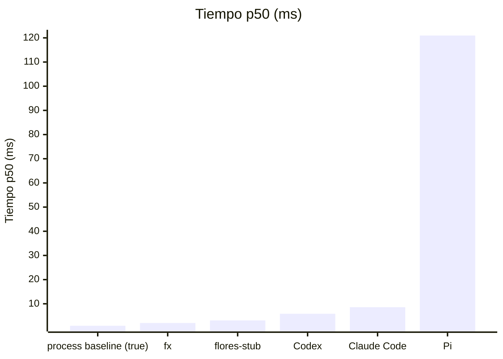

# Resultados publicados

> Fichero generado por `flores-bench publish` / `flores-bench report`. No editar a mano.
> Fuente de verdad: los `latest.json` / `history.jsonl` de cada carpeta.
> Metodología: [`../docs/methodology.md`](../docs/methodology.md).

p50 = mediana; entre corchetes, intervalo de confianza del 95 % de la mediana (bootstrap).

## Overhead del harness: un "hello world" contra el mock provider

### `darwin-arm64`

Commit `sin commit` (dirty) · 2026-11-05T13:40:54Z · Apple M5 · 10 cores · local · 3×5 runs (+1 warmup)

| Agente | Versión | Tiempo p50 (ms) | Harness p50 (ms) | CPU p50 (ms) | RSS p50 (MiB) | Enviado al modelo (KiB) | System prompt (KiB) | Tools | Peticiones |
|---|---|---:|---:|---:|---:|---:|---:|---:|---:|
| flores-stub | 0.0.0-stub | 5.30 [5.1–6.2] | 5.22 | 3.30 | 11.6 | 0.2 | 0.1 | 0 | 1 |
| fx | 0.0.16 | 20.8 [19.6–21.5] | 20.6 | 6.47 | 4.86 | 25.0 | 9.3 | 13 | 1 |
| Claude Code | 2.1.318 | 161.7 [155.5–166.8] | 161.5 | 188.2 | 193.8 | 45.1 | 5.6 | 12 | 1 |
| Pi | 1.5.0 | 165.8 [165.0–166.4] | 165.6 | 193.3 | 113.6 | 5.9 | 2.4 | 0 | 1 |
| Codex | 0.164.0 | 385.7 [361.1–395.5] | 385.1 | 145.8 | 101.8 | 54.6 | 27.1 | 0 | 1 |

## Arranque (`<agent> --version`)

### `darwin-arm64`

Commit `sin commit` (dirty) · 2026-11-05T13:40:41Z · Apple M5 · 10 cores · local · 3×30 runs (+5 warmup)

| Agente | Versión | Tiempo p50 (ms) | CPU p50 (ms) | RSS p50 (MiB) |
|---|---|---:|---:|---:|
| process baseline (true) | - | 0.90 [0.9–0.9] | 0.55 | 1.14 |
| fx | 0.0.16 | 2.06 [2.0–2.1] | 1.03 | 2.11 |
| flores-stub | 0.0.0-stub | 3.12 [3.1–3.1] | 2.16 | 10.0 |
| Codex | 0.164.0 | 5.88 [5.7–6.0] | 5.12 | 19.0 |
| Claude Code | 2.1.318 | 8.59 [8.5–8.7] | 6.39 | 23.2 |
| Pi | 1.5.0 | 121.0 [120.5–121.1] | 127.6 | 103.5 |

