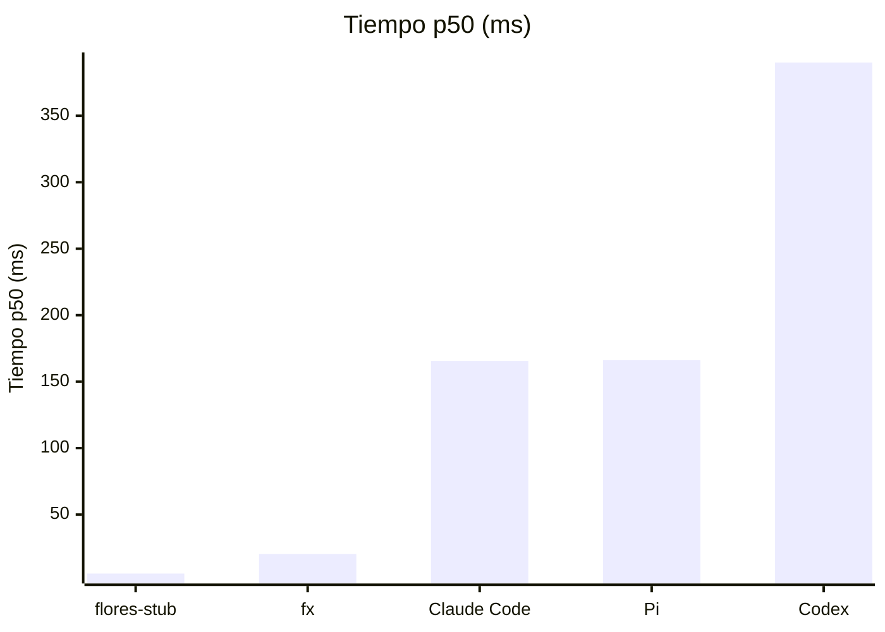
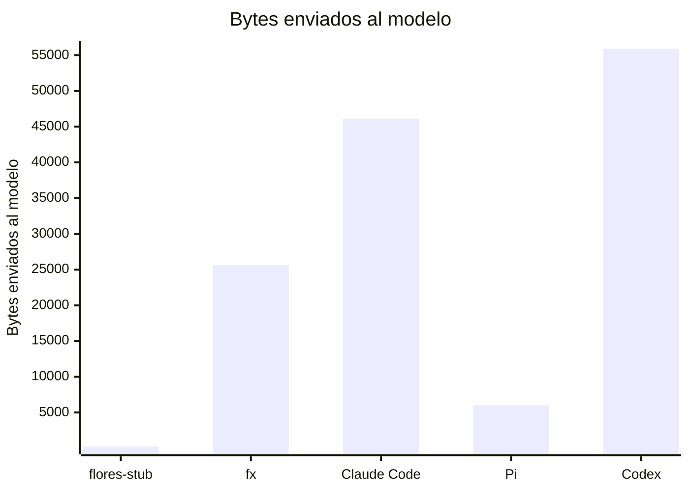

# Resultados publicados

> Fichero generado por `flores-bench publish` / `flores-bench report`. No editar a mano.
> Fuente de verdad: los `latest.json` / `history.jsonl` de cada carpeta.
> Metodología: [`../docs/methodology.md`](../docs/methodology.md).

p50 = mediana; entre corchetes, intervalo de confianza del 95 % de la mediana (bootstrap).

## Overhead del harness: un "hello world" contra el mock provider

### `darwin-arm64`

Commit `5ada8e5662` (dirty) · 2026-11-05T13:53:53Z · Apple M5 · 10 cores · local · 3×5 runs (+1 warmup)

| Agente | Versión | Tiempo p50 (ms) | Harness p50 (ms) | CPU p50 (ms) | RSS p50 (MiB) | Enviado al modelo (KiB) | System prompt (KiB) | Tools | Peticiones |
|---|---|---:|---:|---:|---:|---:|---:|---:|---:|
| flores-stub | 0.0.0-stub | 5.63 [5.2–7.6] | 5.58 | 3.41 | 11.6 | 0.2 | 0.1 | 0 | 1 |
| fx | 0.0.16 | 20.3 [18.9–21.0] | 20.1 | 6.29 | 4.84 | 25.0 | 9.3 | 13 | 1 |
| Claude Code | 2.1.318 | 165.5 [155.6–169.8] | 165.3 | 188.9 | 193.5 | 45.1 | 5.6 | 12 | 1 |
| Pi | 1.5.0 | 166.1 [164.4–166.8] | 165.9 | 192.7 | 113.8 | 5.9 | 2.4 | 0 | 1 |
| Codex | 0.164.0 | 390.1 [368.1–412.7] | 389.7 | 156.9 | 101.7 | 54.6 | 27.1 | 0 | 1 |

## Arranque (`<agent> --version`)

### `darwin-arm64`

Commit `5ada8e5662` (dirty) · 2026-11-05T13:53:39Z · Apple M5 · 10 cores · local · 3×30 runs (+5 warmup)

| Agente | Versión | Tiempo p50 (ms) | CPU p50 (ms) | RSS p50 (MiB) |
|---|---|---:|---:|---:|
| process baseline (true) | - | 0.90 [0.9–0.9] | 0.55 | 1.14 |
| fx | 0.0.16 | 2.06 [2.0–2.1] | 1.04 | 2.11 |
| flores-stub | 0.0.0-stub | 3.12 [3.1–3.1] | 2.15 | 10.0 |
| Codex | 0.164.0 | 5.81 [5.8–5.9] | 5.17 | 19.0 |
| Claude Code | 2.1.318 | 8.58 [8.5–8.6] | 6.42 | 23.2 |
| Pi | 1.5.0 | 121.1 [120.8–121.6] | 127.8 | 103.6 |

