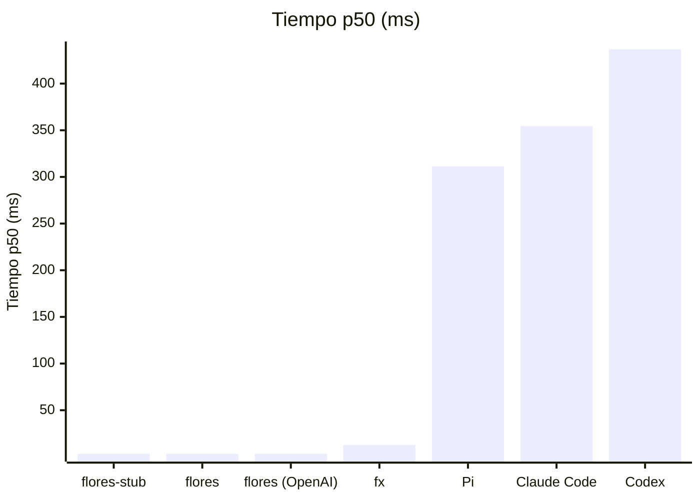
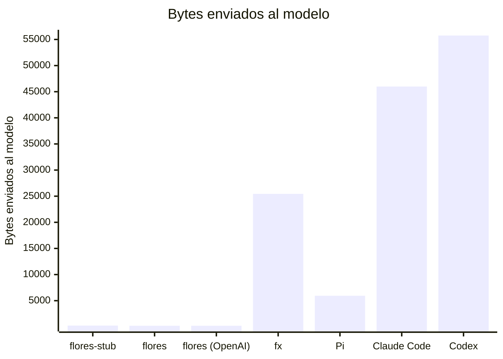
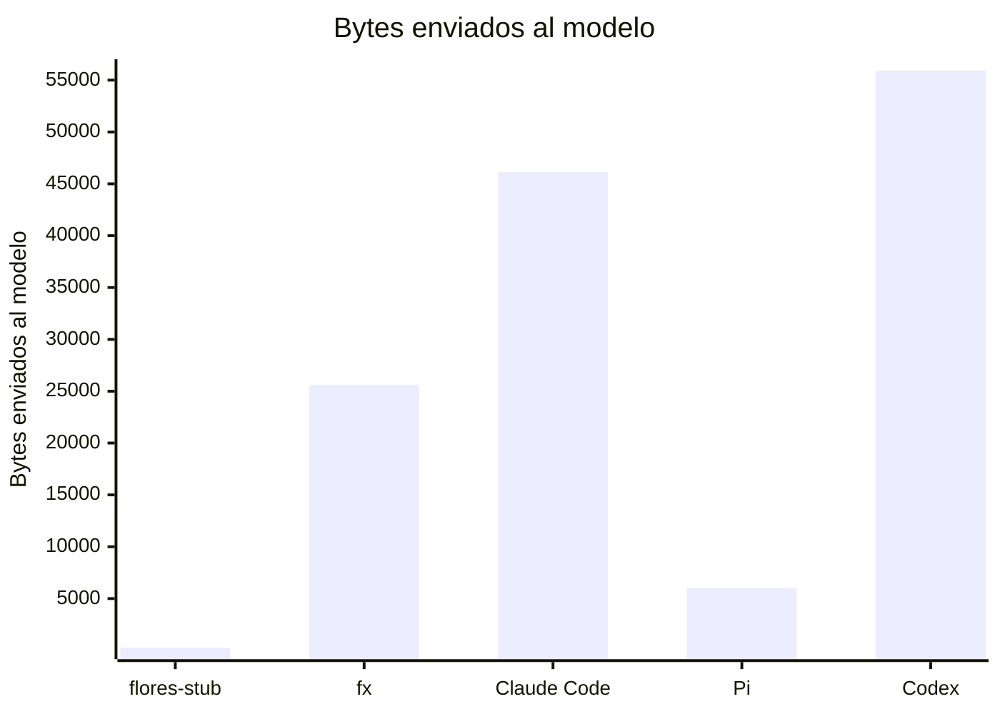
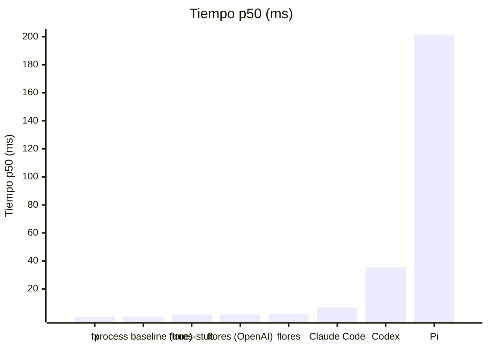

# Resultados publicados

> Fichero generado por `flores-bench publish` / `flores-bench report`. No editar a mano.
> Fuente de verdad: los `latest.json` / `history.jsonl` de cada carpeta.
> Metodología: [`../docs/methodology.md`](../docs/methodology.md).

p50 = mediana; entre corchetes, intervalo de confianza del 95 % de la mediana (bootstrap).

## Comportamiento del harness (capa B): fallos guionizados

### `linux-x86_64`

Commit `7150f1c0af` (dirty) · 2026-11-08T15:31:34Z · 1 ejecución(es) por escenario

Escenarios y su porqué: [`../docs/harness-scenarios.md`](../docs/harness-scenarios.md).

| Escenario | flores 0.0.0-dev | flores (OpenAI) 0.0.0-dev | flores-stub 0.0.0-stub | Pi 1.5.0 | Claude Code 2.1.318 | Codex 0.164.0 | fx 0.0.16 |
|---|:---:|:---:|:---:|:---:|:---:|:---:|:---:|
| **Respuesta de texto simple** `basic-text` · basics | ✅ | ✅ | ✅ | ✅ | ✅ | ✅ | ✅ |
| **Argumentos de tool con JSON roto** `malformed-tool-args` · tools | ✅ | ✅ | ✅ | ✅ | ✅ | — | ✅ |
| **Dos tool calls en el mismo turno** `parallel-tools` · tools | ❌ | ❌ | ❌ | ✅ | ✅ | — | ✅ |
| **Tres turnos de tools encadenados** `tool-chain` · tools | ❌ | ❌ | ❌ | ✅ | ✅ | — | ✅ |
| **Una tool call y su resultado vuelve al modelo** `tool-roundtrip` · tools | ❌ | ❌ | ❌ | ✅ | ✅ | — | ✅ |
| **El modelo pide una tool que no existe** `unknown-tool` · tools | ✅ | ✅ | ✅ | ✅ | ✅ | ✅ | ✅ |
| **401: fallar rápido y sin reintentos** `auth-error-fail-fast` · provider-errors | ✅ | ✅ | ✅ | ✅ | ❌ | ❌ | ✅ |
| **Sin saldo: fallar rápido y sin reintentos** `out-of-credit-fail-fast` · provider-errors | ✅ | ✅ | ✅ | ✅ | ✅ | ✅ | ❌ |
| **429 transitorio: reintentar respetando Retry-After** `rate-limit-recover` · provider-errors | ✅ | ✅ | ❌ | ✅ | ✅ | ✅ | ✅ |
| **429 con Retry-After de una hora: fallar en el acto** `retry-after-too-long` · provider-errors | ✅ | ✅ | ✅ | ❌ | ✅ | ❌ | ❌ |
| **503 transitorio: reintentar** `server-error-recover` · provider-errors | ✅ | ✅ | ❌ | ✅ | ✅ | ✅ | ✅ |
| **Respuesta de 1 MiB** `huge-output` · streaming | ✅ | ✅ | ✅ | ✅ | ✅ | ✅ | ✅ |
| **Primer token a los 8 s** `slow-first-token` · streaming | ✅ | ✅ | ✅ | ✅ | ✅ | ✅ | ✅ |
| **Stream cortado a mitad: reintentar** `stream-truncated-recover` · streaming | ✅ | ✅ | ❌ | ✅ | ✅ | ✅ | ✅ |
| **El modelo pide tools sin fin** `runaway-tool-loop` · limits | ✅ | ✅ | ✅ | ❌ | ❌ | ❌ | ❌ |
| Superados / aplicables | **12/15** | **12/15** | **9/15** | **13/15** | **13/15** | **8/11** | **12/15** |

✅ cumple la especificación · ❌ no la cumple · — no aplicable al agente · ⚠️ error del runner

Por qué falla cada caso

- **flores** · `parallel-tools`: request_contains: esperado flores-11, observado absent; request_contains: esperado flores-22, observado absent (exit 0, 2 peticiones, 4 ms)
- **flores** · `tool-chain`: request_contains: esperado flores-101, observado absent; request_contains: esperado flores-102, observado absent; request_contains: esperado flores-103, observado absent (exit 0, 4 peticiones, 5 ms)
- **flores** · `tool-roundtrip`: request_contains: esperado flores-42, observado absent (exit 0, 2 peticiones, 4 ms)
- **flores (OpenAI)** · `parallel-tools`: request_contains: esperado flores-11, observado absent; request_contains: esperado flores-22, observado absent (exit 0, 2 peticiones, 4 ms)
- **flores (OpenAI)** · `tool-chain`: request_contains: esperado flores-101, observado absent; request_contains: esperado flores-102, observado absent; request_contains: esperado flores-103, observado absent (exit 0, 4 peticiones, 5 ms)
- **flores (OpenAI)** · `tool-roundtrip`: request_contains: esperado flores-42, observado absent (exit 0, 2 peticiones, 4 ms)
- **flores-stub** · `parallel-tools`: request_contains: esperado flores-11, observado absent; request_contains: esperado flores-22, observado absent (exit 0, 2 peticiones, 5 ms)
- **flores-stub** · `tool-chain`: request_contains: esperado flores-101, observado absent; request_contains: esperado flores-102, observado absent; request_contains: esperado flores-103, observado absent (exit 0, 4 peticiones, 5 ms)
- **flores-stub** · `tool-roundtrip`: request_contains: esperado flores-42, observado absent (exit 0, 2 peticiones, 4 ms)
- **flores-stub** · `rate-limit-recover`: exit: esperado zero, observado 3; stdout_contains: esperado Recovered after rate limit., observado ; llm_requests: esperado {'min': 3, 'max': 3}, observado 1; retries: esperado {'min': 2, 'max': 2}, observado 0 (exit 3, 1 peticiones, 3 ms)
- **flores-stub** · `server-error-recover`: exit: esperado zero, observado 3; stdout_contains: esperado Recovered after server error., observado ; retries: esperado {'min': 1, 'max': 1}, observado 0 (exit 3, 1 peticiones, 3 ms)
- **flores-stub** · `stream-truncated-recover`: exit: esperado zero, observado 3; stdout_contains: esperado The quick brown fox jumps over the lazy dog., observado ; retries: esperado {'min': 1}, observado 0 (exit 3, 1 peticiones, 4 ms)
- **Pi** · `retry-after-too-long`: llm_requests: esperado {'min': 1, 'max': 1}, observado 4; max_wall_ms: esperado 5000, observado 14353 (exit 1, 4 peticiones, 14353 ms)
- **Pi** · `runaway-tool-loop`: completes: esperado exits before timeout, observado timeout; llm_requests: esperado {'max': 50}, observado 2157 (exit -9, 2157 peticiones, 45070 ms)
- **Claude Code** · `auth-error-fail-fast`: completes: esperado exits before timeout, observado timeout; llm_requests: esperado {'min': 1, 'max': 1}, observado 7; max_wall_ms: esperado 10000, observado 60070 (exit -9, 7 peticiones, 60070 ms)
- **Claude Code** · `runaway-tool-loop`: completes: esperado exits before timeout, observado timeout; llm_requests: esperado {'max': 50}, observado 1588 (exit -9, 1588 peticiones, 45066 ms)
- **Codex** · `auth-error-fail-fast`: llm_requests: esperado {'min': 1, 'max': 1}, observado 6 (exit 1, 6 peticiones, 6267 ms)
- **Codex** · `retry-after-too-long`: completes: esperado exits before timeout, observado timeout; max_wall_ms: esperado 5000, observado 45008 (exit -9, 1 peticiones, 45008 ms)
- **Codex** · `runaway-tool-loop`: completes: esperado exits before timeout, observado timeout; llm_requests: esperado {'max': 50}, observado 1814 (exit -9, 1814 peticiones, 45009 ms)
- **fx** · `out-of-credit-fail-fast`: completes: esperado exits before timeout, observado timeout; llm_requests: esperado {'min': 1, 'max': 1}, observado 7; max_wall_ms: esperado 5000, observado 60034 (exit -9, 7 peticiones, 60034 ms)
- **fx** · `retry-after-too-long`: completes: esperado exits before timeout, observado timeout; llm_requests: esperado {'min': 1, 'max': 1}, observado 2; max_wall_ms: esperado 5000, observado 45001 (exit -9, 2 peticiones, 45001 ms)
- **fx** · `runaway-tool-loop`: completes: esperado exits before timeout, observado timeout; llm_requests: esperado {'max': 50}, observado 2480 (exit -9, 2480 peticiones, 45049 ms)

### `darwin-arm64`

Commit `65006b335b` (dirty) · 2026-11-05T14:13:36Z · 1 ejecución(es) por escenario

Escenarios y su porqué: [`../docs/harness-scenarios.md`](../docs/harness-scenarios.md).

| Escenario | flores-stub 0.0.0-stub | Pi 1.5.0 | Claude Code 2.1.318 | Codex 0.164.0 | fx 0.0.16 |
|---|:---:|:---:|:---:|:---:|:---:|
| **Respuesta de texto simple** `basic-text` · basics | ✅ | ✅ | ✅ | ✅ | ✅ |
| **Argumentos de tool con JSON roto** `malformed-tool-args` · tools | ✅ | ✅ | ✅ | — | ✅ |
| **Dos tool calls en el mismo turno** `parallel-tools` · tools | ❌ | ✅ | ✅ | — | ✅ |
| **Tres turnos de tools encadenados** `tool-chain` · tools | ❌ | ✅ | ✅ | — | ✅ |
| **Una tool call y su resultado vuelve al modelo** `tool-roundtrip` · tools | ❌ | ✅ | ✅ | — | ✅ |
| **El modelo pide una tool que no existe** `unknown-tool` · tools | ✅ | ✅ | ✅ | ✅ | ✅ |
| **401: fallar rápido y sin reintentos** `auth-error-fail-fast` · provider-errors | ✅ | ✅ | ❌ | ❌ | ✅ |
| **429 transitorio: reintentar respetando Retry-After** `rate-limit-recover` · provider-errors | ❌ | ✅ | ✅ | ✅ | ✅ |
| **503 transitorio: reintentar** `server-error-recover` · provider-errors | ❌ | ✅ | ✅ | ✅ | ✅ |
| **Respuesta de 1 MiB** `huge-output` · streaming | ✅ | ✅ | ✅ | ✅ | ✅ |
| **Primer token a los 8 s** `slow-first-token` · streaming | ✅ | ✅ | ✅ | ✅ | ✅ |
| **Stream cortado a mitad: reintentar** `stream-truncated-recover` · streaming | ❌ | ✅ | ✅ | ✅ | ✅ |
| **El modelo pide tools sin fin** `runaway-tool-loop` · limits | ✅ | ❌ | ❌ | ❌ | ❌ |
| Superados / aplicables | **7/13** | **12/13** | **11/13** | **7/9** | **12/13** |

✅ cumple la especificación · ❌ no la cumple · — no aplicable al agente · ⚠️ error del runner

Por qué falla cada caso

- **flores-stub** · `parallel-tools`: request_contains: esperado flores-11, observado absent; request_contains: esperado flores-22, observado absent (exit 0, 2 peticiones, 7 ms)
- **flores-stub** · `tool-chain`: request_contains: esperado flores-101, observado absent; request_contains: esperado flores-102, observado absent; request_contains: esperado flores-103, observado absent (exit 0, 4 peticiones, 8 ms)
- **flores-stub** · `tool-roundtrip`: request_contains: esperado flores-42, observado absent (exit 0, 2 peticiones, 6 ms)
- **flores-stub** · `rate-limit-recover`: exit: esperado zero, observado 3; stdout_contains: esperado Recovered after rate limit., observado ; llm_requests: esperado {'min': 3, 'max': 3}, observado 1; retries: esperado {'min': 2, 'max': 2}, observado 0 (exit 3, 1 peticiones, 6 ms)
- **flores-stub** · `server-error-recover`: exit: esperado zero, observado 3; stdout_contains: esperado Recovered after server error., observado ; retries: esperado {'min': 1, 'max': 1}, observado 0 (exit 3, 1 peticiones, 6 ms)
- **flores-stub** · `stream-truncated-recover`: exit: esperado zero, observado 3; stdout_contains: esperado The quick brown fox jumps over the lazy dog., observado ; retries: esperado {'min': 1}, observado 0 (exit 3, 1 peticiones, 11 ms)
- **Pi** · `runaway-tool-loop`: completes: esperado exits before timeout, observado timeout; llm_requests: esperado {'max': 50}, observado 3485 (exit -9, 3485 peticiones, 45007 ms)
- **Claude Code** · `auth-error-fail-fast`: completes: esperado exits before timeout, observado timeout; llm_requests: esperado {'min': 1, 'max': 1}, observado 7; max_wall_ms: esperado 10000, observado 60010 (exit -9, 7 peticiones, 60010 ms)
- **Claude Code** · `runaway-tool-loop`: completes: esperado exits before timeout, observado timeout; llm_requests: esperado {'max': 50}, observado 3072 (exit -9, 3072 peticiones, 45006 ms)
- **Codex** · `auth-error-fail-fast`: llm_requests: esperado {'min': 1, 'max': 1}, observado 6 (exit 1, 6 peticiones, 6479 ms)
- **Codex** · `runaway-tool-loop`: completes: esperado exits before timeout, observado timeout; llm_requests: esperado {'max': 50}, observado 7217 (exit -9, 7217 peticiones, 45005 ms)
- **fx** · `runaway-tool-loop`: completes: esperado exits before timeout, observado timeout; llm_requests: esperado {'max': 50}, observado 2822 (exit -9, 2822 peticiones, 45001 ms)

## Overhead del harness: un "hello world" contra el mock provider

### `linux-x86_64` (referencia)

Commit `7150f1c0af` (dirty) · 2026-11-08T15:23:01Z · INTEL(R) XEON(R) PLATINUM 8573C · 4 cores · CI · 3×5 runs (+1 warmup)

| Agente | Versión | Tiempo p50 (ms) | Harness p50 (ms) | CPU p50 (ms) | RSS p50 (MiB) | Enviado al modelo (KiB) | System prompt (KiB) | Tools | Peticiones |
|---|---|---:|---:|---:|---:|---:|---:|---:|---:|
| flores-stub | 0.0.0-stub | 3.35 [3.2–3.6] | 3.12 | 3.66 | 7.74 | 0.2 | 0.1 | 0 | 1 |
| flores | 0.0.0-dev | 3.37 [3.3–4.1] | 3.15 | 3.86 | 7.90 | 0.2 | 0.0 | 0 | 1 |
| flores (OpenAI) | 0.0.0-dev | 3.46 [3.4–3.6] | 3.25 | 3.92 | 7.96 | 0.2 | 0.0 | 0 | 1 |
| fx | 0.0.16 | 12.7 [12.6–12.9] | 12.0 | 2.69 | 7.03 | 24.9 | 9.1 | 13 | 1 |
| Pi | 1.5.0 | 311.4 [308.0–319.9] | 310.9 | 424.1 | 112.8 | 5.8 | 2.3 | 4 | 1 |
| Claude Code | 2.1.318 | 354.4 [348.7–357.8] | 353.2 | 399.5 | 197.7 | 44.9 | 5.5 | 12 | 1 |
| Codex | 0.164.0 | 436.6 [432.3–445.8] | 434.1 | 418.9 | 154.9 | 54.5 | 27.0 | 11 | 1 |

### `darwin-arm64`

Commit `65006b335b` (dirty) · 2026-11-05T14:14:17Z · Apple M5 · 10 cores · local · 3×5 runs (+1 warmup)

| Agente | Versión | Tiempo p50 (ms) | Harness p50 (ms) | CPU p50 (ms) | RSS p50 (MiB) | Enviado al modelo (KiB) | System prompt (KiB) | Tools | Peticiones |
|---|---|---:|---:|---:|---:|---:|---:|---:|---:|
| flores-stub | 0.0.0-stub | 5.72 [5.2–5.9] | 5.66 | 3.46 | 11.6 | 0.2 | 0.1 | 0 | 1 |
| fx | 0.0.16 | 19.6 [18.8–21.9] | 19.4 | 5.91 | 4.86 | 25.0 | 9.3 | 13 | 1 |
| Claude Code | 2.1.318 | 163.4 [158.0–169.9] | 163.2 | 190.6 | 193.6 | 45.1 | 5.6 | 12 | 1 |
| Pi | 1.5.0 | 168.3 [167.5–169.6] | 168.1 | 196.3 | 113.8 | 5.9 | 2.4 | 4 | 1 |
| Codex | 0.164.0 | 388.1 [365.0–407.0] | 387.7 | 142.0 | 101.6 | 54.6 | 27.1 | 11 | 1 |

## Arranque (`<agent> --version`)

### `linux-x86_64` (referencia)

Commit `7150f1c0af` (dirty) · 2026-11-08T15:22:37Z · INTEL(R) XEON(R) PLATINUM 8573C · 4 cores · CI · 3×30 runs (+5 warmup)

| Agente | Versión | Tiempo p50 (ms) | CPU p50 (ms) | RSS p50 (MiB) |
|---|---|---:|---:|---:|
| fx | 0.0.16 | 0.22 [0.2–0.2] | 0.16 | ≤ 2.5 |
| process baseline (true) | - | 0.38 [0.4–0.4] | 0.32 | ≤ 2.6 |
| flores-stub | 0.0.0-stub | 1.79 [1.8–1.8] | 2.08 | 6.40 |
| flores (OpenAI) | 0.0.0-dev | 1.84 [1.8–1.9] | 2.16 | 6.46 |
| flores | 0.0.0-dev | 1.86 [1.8–1.9] | 2.18 | 6.46 |
| Claude Code | 2.1.318 | 6.90 [6.6–7.1] | 6.68 | 25.3 |
| Codex | 0.164.0 | 35.5 [34.7–35.8] | 38.9 | 50.9 |
| Pi | 1.5.0 | 201.7 [200.2–203.1] | 261.1 | 102.8 |

### `darwin-arm64`

Commit `65006b335b` (dirty) · 2026-11-05T14:14:04Z · Apple M5 · 10 cores · local · 3×30 runs (+5 warmup)

| Agente | Versión | Tiempo p50 (ms) | CPU p50 (ms) | RSS p50 (MiB) |
|---|---|---:|---:|---:|
| process baseline (true) | - | 0.91 [0.9–0.9] | 0.55 | 1.14 |
| fx | 0.0.16 | 2.07 [2.1–2.1] | 1.03 | 2.11 |
| flores-stub | 0.0.0-stub | 3.13 [3.1–3.2] | 2.15 | 10.0 |
| Codex | 0.164.0 | 5.91 [5.8–6.0] | 5.22 | 19.0 |
| Claude Code | 2.1.318 | 8.54 [8.4–8.6] | 6.35 | 23.2 |
| Pi | 1.5.0 | 123.4 [122.8–123.7] | 129.9 | 103.6 |

