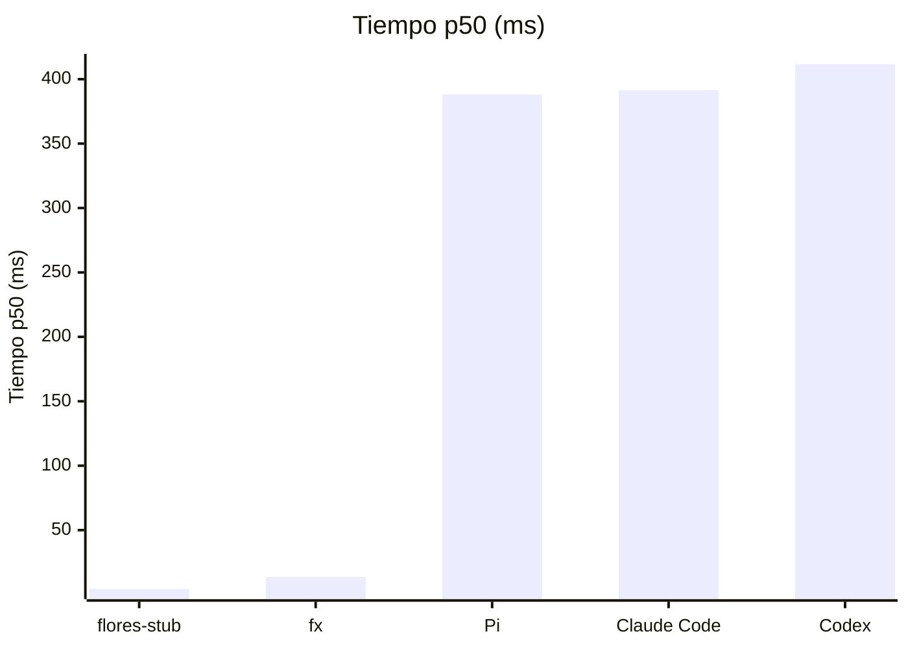
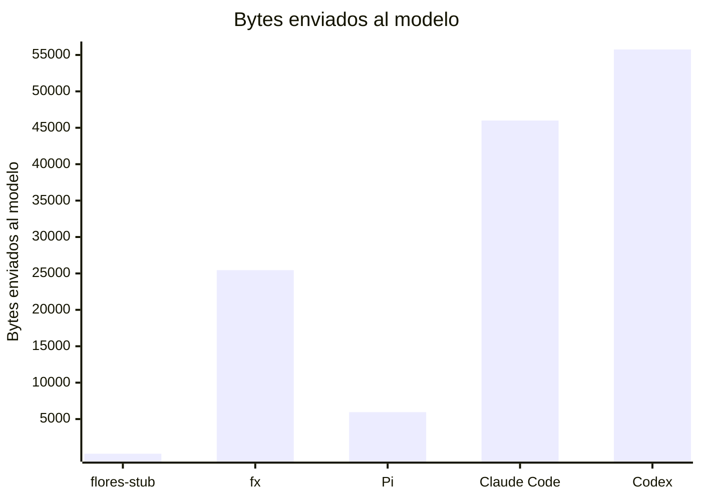
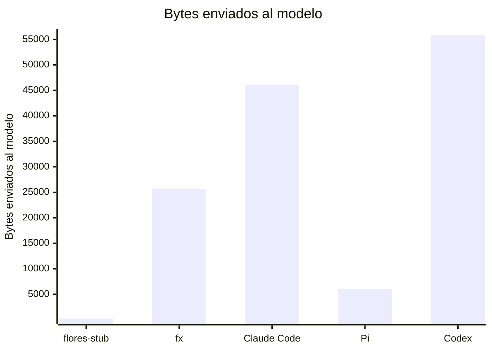
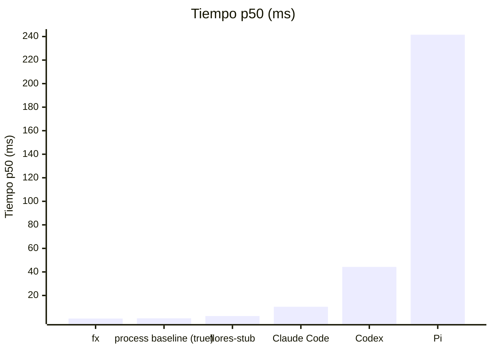

# Resultados publicados

> Fichero generado por `flores-bench publish` / `flores-bench report`. No editar a mano.
> Fuente de verdad: los `latest.json` / `history.jsonl` de cada carpeta.
> Metodología: [`../docs/methodology.md`](../docs/methodology.md).

p50 = mediana; entre corchetes, intervalo de confianza del 95 % de la mediana (bootstrap).

## Comportamiento del harness (capa B): fallos guionizados

### `linux-x86_64`

Commit `029dc1ff42` (dirty) · 2026-11-06T10:31:20Z · 1 ejecución(es) por escenario

Escenarios y su porqué: [`../docs/harness-scenarios.md`](../docs/harness-scenarios.md).

| Escenario | flores-stub 0.0.0-stub | Pi 1.5.0 | Claude Code 2.1.318 | Codex 0.164.0 | fx 0.0.16 |
|---|:---:|:---:|:---:|:---:|:---:|
| **Respuesta de texto simple** `basic-text` · basics | ✅ | ✅ | ✅ | ✅ | ✅ |
| **Argumentos de tool con JSON roto** `malformed-tool-args` · tools | ✅ | ✅ | ✅ | — | ✅ |
| **Dos tool calls en el mismo turno** `parallel-tools` · tools | ❌ | ✅ | ✅ | — | ✅ |
| **Tres turnos de tools encadenados** `tool-chain` · tools | ❌ | ✅ | ✅ | — | ✅ |
| **Una tool call y su resultado vuelve al modelo** `tool-roundtrip` · tools | ❌ | ✅ | ✅ | — | ✅ |
| **El modelo pide una tool que no existe** `unknown-tool` · tools | ✅ | ✅ | ✅ | ✅ | ✅ |
| **401: fallar rápido y sin reintentos** `auth-error-fail-fast` · provider-errors | ✅ | ✅ | ❌ | ❌ | ✅ |
| **429 transitorio: reintentar respetando Retry-After** `rate-limit-recover` · provider-errors | ❌ | ✅ | ✅ | ✅ | ✅ |
| **503 transitorio: reintentar** `server-error-recover` · provider-errors | ❌ | ✅ | ✅ | ✅ | ✅ |
| **Respuesta de 1 MiB** `huge-output` · streaming | ✅ | ✅ | ✅ | ✅ | ✅ |
| **Primer token a los 8 s** `slow-first-token` · streaming | ✅ | ✅ | ✅ | ✅ | ✅ |
| **Stream cortado a mitad: reintentar** `stream-truncated-recover` · streaming | ❌ | ✅ | ✅ | ✅ | ✅ |
| **El modelo pide tools sin fin** `runaway-tool-loop` · limits | ✅ | ❌ | ❌ | ❌ | ❌ |
| Superados / aplicables | **7/13** | **12/13** | **11/13** | **7/9** | **12/13** |

✅ cumple la especificación · ❌ no la cumple · — no aplicable al agente · ⚠️ error del runner

Por qué falla cada caso

- **flores-stub** · `parallel-tools`: request_contains: esperado flores-11, observado absent; request_contains: esperado flores-22, observado absent (exit 0, 2 peticiones, 6 ms)
- **flores-stub** · `tool-chain`: request_contains: esperado flores-101, observado absent; request_contains: esperado flores-102, observado absent; request_contains: esperado flores-103, observado absent (exit 0, 4 peticiones, 6 ms)
- **flores-stub** · `tool-roundtrip`: request_contains: esperado flores-42, observado absent (exit 0, 2 peticiones, 5 ms)
- **flores-stub** · `rate-limit-recover`: exit: esperado zero, observado 3; stdout_contains: esperado Recovered after rate limit., observado ; llm_requests: esperado {'min': 3, 'max': 3}, observado 1; retries: esperado {'min': 2, 'max': 2}, observado 0 (exit 3, 1 peticiones, 5 ms)
- **flores-stub** · `server-error-recover`: exit: esperado zero, observado 3; stdout_contains: esperado Recovered after server error., observado ; retries: esperado {'min': 1, 'max': 1}, observado 0 (exit 3, 1 peticiones, 5 ms)
- **flores-stub** · `stream-truncated-recover`: exit: esperado zero, observado 3; stdout_contains: esperado The quick brown fox jumps over the lazy dog., observado ; retries: esperado {'min': 1}, observado 0 (exit 3, 1 peticiones, 5 ms)
- **Pi** · `runaway-tool-loop`: completes: esperado exits before timeout, observado timeout; llm_requests: esperado {'max': 50}, observado 1931 (exit -9, 1931 peticiones, 45080 ms)
- **Claude Code** · `auth-error-fail-fast`: completes: esperado exits before timeout, observado timeout; llm_requests: esperado {'min': 1, 'max': 1}, observado 7; max_wall_ms: esperado 10000, observado 60058 (exit -9, 7 peticiones, 60058 ms)
- **Claude Code** · `runaway-tool-loop`: completes: esperado exits before timeout, observado timeout; llm_requests: esperado {'max': 50}, observado 1363 (exit -9, 1363 peticiones, 45072 ms)
- **Codex** · `auth-error-fail-fast`: llm_requests: esperado {'min': 1, 'max': 1}, observado 6 (exit 1, 6 peticiones, 6412 ms)
- **Codex** · `runaway-tool-loop`: completes: esperado exits before timeout, observado timeout; llm_requests: esperado {'max': 50}, observado 1679 (exit -9, 1679 peticiones, 45046 ms)
- **fx** · `runaway-tool-loop`: completes: esperado exits before timeout, observado timeout; llm_requests: esperado {'max': 50}, observado 2278 (exit -9, 2278 peticiones, 45029 ms)

### `darwin-arm64`

Commit `65006b335b` (dirty) · 2026-11-05T14:13:36Z · 1 ejecución(es) por escenario

Escenarios y su porqué: [`../docs/harness-scenarios.md`](../docs/harness-scenarios.md).

| Escenario | flores-stub 0.0.0-stub | Pi 1.5.0 | Claude Code 2.1.318 | Codex 0.164.0 | fx 0.0.16 |
|---|:---:|:---:|:---:|:---:|:---:|
| **Respuesta de texto simple** `basic-text` · basics | ✅ | ✅ | ✅ | ✅ | ✅ |
| **Argumentos de tool con JSON roto** `malformed-tool-args` · tools | ✅ | ✅ | ✅ | — | ✅ |
| **Dos tool calls en el mismo turno** `parallel-tools` · tools | ❌ | ✅ | ✅ | — | ✅ |
| **Tres turnos de tools encadenados** `tool-chain` · tools | ❌ | ✅ | ✅ | — | ✅ |
| **Una tool call y su resultado vuelve al modelo** `tool-roundtrip` · tools | ❌ | ✅ | ✅ | — | ✅ |
| **El modelo pide una tool que no existe** `unknown-tool` · tools | ✅ | ✅ | ✅ | ✅ | ✅ |
| **401: fallar rápido y sin reintentos** `auth-error-fail-fast` · provider-errors | ✅ | ✅ | ❌ | ❌ | ✅ |
| **429 transitorio: reintentar respetando Retry-After** `rate-limit-recover` · provider-errors | ❌ | ✅ | ✅ | ✅ | ✅ |
| **503 transitorio: reintentar** `server-error-recover` · provider-errors | ❌ | ✅ | ✅ | ✅ | ✅ |
| **Respuesta de 1 MiB** `huge-output` · streaming | ✅ | ✅ | ✅ | ✅ | ✅ |
| **Primer token a los 8 s** `slow-first-token` · streaming | ✅ | ✅ | ✅ | ✅ | ✅ |
| **Stream cortado a mitad: reintentar** `stream-truncated-recover` · streaming | ❌ | ✅ | ✅ | ✅ | ✅ |
| **El modelo pide tools sin fin** `runaway-tool-loop` · limits | ✅ | ❌ | ❌ | ❌ | ❌ |
| Superados / aplicables | **7/13** | **12/13** | **11/13** | **7/9** | **12/13** |

✅ cumple la especificación · ❌ no la cumple · — no aplicable al agente · ⚠️ error del runner

Por qué falla cada caso

- **flores-stub** · `parallel-tools`: request_contains: esperado flores-11, observado absent; request_contains: esperado flores-22, observado absent (exit 0, 2 peticiones, 7 ms)
- **flores-stub** · `tool-chain`: request_contains: esperado flores-101, observado absent; request_contains: esperado flores-102, observado absent; request_contains: esperado flores-103, observado absent (exit 0, 4 peticiones, 8 ms)
- **flores-stub** · `tool-roundtrip`: request_contains: esperado flores-42, observado absent (exit 0, 2 peticiones, 6 ms)
- **flores-stub** · `rate-limit-recover`: exit: esperado zero, observado 3; stdout_contains: esperado Recovered after rate limit., observado ; llm_requests: esperado {'min': 3, 'max': 3}, observado 1; retries: esperado {'min': 2, 'max': 2}, observado 0 (exit 3, 1 peticiones, 6 ms)
- **flores-stub** · `server-error-recover`: exit: esperado zero, observado 3; stdout_contains: esperado Recovered after server error., observado ; retries: esperado {'min': 1, 'max': 1}, observado 0 (exit 3, 1 peticiones, 6 ms)
- **flores-stub** · `stream-truncated-recover`: exit: esperado zero, observado 3; stdout_contains: esperado The quick brown fox jumps over the lazy dog., observado ; retries: esperado {'min': 1}, observado 0 (exit 3, 1 peticiones, 11 ms)
- **Pi** · `runaway-tool-loop`: completes: esperado exits before timeout, observado timeout; llm_requests: esperado {'max': 50}, observado 3485 (exit -9, 3485 peticiones, 45007 ms)
- **Claude Code** · `auth-error-fail-fast`: completes: esperado exits before timeout, observado timeout; llm_requests: esperado {'min': 1, 'max': 1}, observado 7; max_wall_ms: esperado 10000, observado 60010 (exit -9, 7 peticiones, 60010 ms)
- **Claude Code** · `runaway-tool-loop`: completes: esperado exits before timeout, observado timeout; llm_requests: esperado {'max': 50}, observado 3072 (exit -9, 3072 peticiones, 45006 ms)
- **Codex** · `auth-error-fail-fast`: llm_requests: esperado {'min': 1, 'max': 1}, observado 6 (exit 1, 6 peticiones, 6479 ms)
- **Codex** · `runaway-tool-loop`: completes: esperado exits before timeout, observado timeout; llm_requests: esperado {'max': 50}, observado 7217 (exit -9, 7217 peticiones, 45005 ms)
- **fx** · `runaway-tool-loop`: completes: esperado exits before timeout, observado timeout; llm_requests: esperado {'max': 50}, observado 2822 (exit -9, 2822 peticiones, 45001 ms)

## Overhead del harness: un "hello world" contra el mock provider

### `linux-x86_64` (referencia)

Commit `029dc1ff42` (dirty) · 2026-11-06T10:25:53Z · AMD EPYC 7763 64-Core Processor · 4 cores · CI · 3×5 runs (+1 warmup)

| Agente | Versión | Tiempo p50 (ms) | Harness p50 (ms) | CPU p50 (ms) | RSS p50 (MiB) | Enviado al modelo (KiB) | System prompt (KiB) | Tools | Peticiones |
|---|---|---:|---:|---:|---:|---:|---:|---:|---:|
| flores-stub | 0.0.0-stub | 4.33 [4.3–5.0] | 4.02 | 4.76 | 7.61 | 0.2 | 0.1 | 0 | 1 |
| fx | 0.0.16 | 13.7 [13.6–13.8] | 12.8 | 3.71 | 7.04 | 24.9 | 9.1 | 13 | 1 |
| Pi | 1.5.0 | 388.1 [384.1–389.8] | 387.4 | 516.3 | 112.5 | 5.8 | 2.3 | 4 | 1 |
| Claude Code | 2.1.318 | 391.5 [387.5–400.7] | 389.9 | 459.4 | 197.9 | 44.9 | 5.5 | 12 | 1 |
| Codex | 0.164.0 | 411.7 [393.4–433.6] | 409.3 | 541.5 | 154.2 | 54.5 | 27.0 | 11 | 1 |

### `darwin-arm64`

Commit `65006b335b` (dirty) · 2026-11-05T14:14:17Z · Apple M5 · 10 cores · local · 3×5 runs (+1 warmup)

| Agente | Versión | Tiempo p50 (ms) | Harness p50 (ms) | CPU p50 (ms) | RSS p50 (MiB) | Enviado al modelo (KiB) | System prompt (KiB) | Tools | Peticiones |
|---|---|---:|---:|---:|---:|---:|---:|---:|---:|
| flores-stub | 0.0.0-stub | 5.72 [5.2–5.9] | 5.66 | 3.46 | 11.6 | 0.2 | 0.1 | 0 | 1 |
| fx | 0.0.16 | 19.6 [18.8–21.9] | 19.4 | 5.91 | 4.86 | 25.0 | 9.3 | 13 | 1 |
| Claude Code | 2.1.318 | 163.4 [158.0–169.9] | 163.2 | 190.6 | 193.6 | 45.1 | 5.6 | 12 | 1 |
| Pi | 1.5.0 | 168.3 [167.5–169.6] | 168.1 | 196.3 | 113.8 | 5.9 | 2.4 | 4 | 1 |
| Codex | 0.164.0 | 388.1 [365.0–407.0] | 387.7 | 142.0 | 101.6 | 54.6 | 27.1 | 11 | 1 |

## Arranque (`<agent> --version`)

### `linux-x86_64` (referencia)

Commit `029dc1ff42` (dirty) · 2026-11-06T10:25:30Z · AMD EPYC 7763 64-Core Processor · 4 cores · CI · 3×30 runs (+5 warmup)

| Agente | Versión | Tiempo p50 (ms) | CPU p50 (ms) | RSS p50 (MiB) |
|---|---|---:|---:|---:|
| fx | 0.0.16 | 0.40 [0.4–0.4] | 0.32 | ≤ 2.5 |
| process baseline (true) | - | 0.59 [0.6–0.6] | 0.50 | ≤ 2.6 |
| flores-stub | 0.0.0-stub | 2.51 [2.5–2.5] | 2.94 | 6.18 |
| Claude Code | 2.1.318 | 10.4 [10.3–10.7] | 10.2 | 28.9 |
| Codex | 0.164.0 | 44.3 [44.2–44.7] | 48.6 | 50.9 |
| Pi | 1.5.0 | 241.6 [240.8–242.3] | 309.5 | 102.2 |

### `darwin-arm64`

Commit `65006b335b` (dirty) · 2026-11-05T14:14:04Z · Apple M5 · 10 cores · local · 3×30 runs (+5 warmup)

| Agente | Versión | Tiempo p50 (ms) | CPU p50 (ms) | RSS p50 (MiB) |
|---|---|---:|---:|---:|
| process baseline (true) | - | 0.91 [0.9–0.9] | 0.55 | 1.14 |
| fx | 0.0.16 | 2.07 [2.1–2.1] | 1.03 | 2.11 |
| flores-stub | 0.0.0-stub | 3.13 [3.1–3.2] | 2.15 | 10.0 |
| Codex | 0.164.0 | 5.91 [5.8–6.0] | 5.22 | 19.0 |
| Claude Code | 2.1.318 | 8.54 [8.4–8.6] | 6.35 | 23.2 |
| Pi | 1.5.0 | 123.4 [122.8–123.7] | 129.9 | 103.6 |

